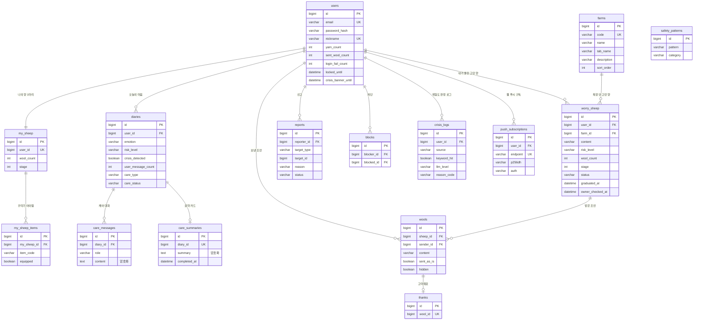

# ERD

기능명세서 7장 데이터 모델(2026-11-08, 와이어프레임 v2 기준)을 기준으로 합니다. 명세서 대비 추가한 컬럼은 아래 "명세서와 다른 점"에 정리했습니다.

## 인덱스 · 제약

| 테이블 | 이름 | 컬럼 | 목적 |
| --- | --- | --- | --- |
| worry_sheep | idx_worry_farm_status_wool_created | farm_id, status, wool_count, created_at | 털 적은 양 먼저 (FRM-02) |
| worry_sheep | idx_worry_user_created | user_id, created_at | 내 고민 양, 하루 한도 (FRM-04, FRM-05) |
| wools | uk_wool_sheep_sender (UNIQUE) | sheep_id, sender_id | 1인 1조언 (WOL-01) |
| diaries | idx_diary_user_created | user_id, created_at | 기록 달력·목록, 하루 한도 (DRY-01, DRY-02) |
| diaries | idx_diary_user_care | user_id, care_type, care_status | 케어 방식별 집계 (REV-02) |
| my_sheep | user_id (UNIQUE) | user_id | 회원당 나의 양 1마리 |
| care_summaries | diary_id (UNIQUE) | diary_id | 오늘의 마음당 마무리 카드 1개 |
| thanks | wool_id (UNIQUE) | wool_id | 조언당 고마워요 1회 (WOL-03) |
| reports | uk_report_reporter_target (UNIQUE) | reporter_id, target_type, target_id | 중복 신고 방지 |
| blocks | uk_block_pair (UNIQUE) | blocker_id, blocked_id | 중복 차단 방지 |
| safety_patterns | uk_safety_pattern (UNIQUE) | category, pattern | 중복 패턴 방지 |

## 명세서와 다른 점

- `users.email`: 와이어프레임 v2에 따라 아이디 대신 이메일로 로그인 (다른 사용자에게 노출하지 않음)
- `diaries.crisis_detected`, `diaries.user_message_count`: 위기 대화는 털 없음, 사용자 메시지 3회부터 털 쌓기 (SAF-02, CARE-02)
- `farms.tab_name`: 목장 화면 주제 탭 이름
- `wools.sent_as_is`: 어조 제안을 받고도 그대로 보낸 조언 (SAF-04)
- `wools.hidden`: 신고 누적으로 숨긴 조언. 주인 상세의 받은 조언 목록에서 빠짐 (RPT-01)
- `worry_sheep.owner_checked_at`: 주인이 마지막으로 상세를 본 시각. 내 고민의 '새 털 n올' 계산에 사용 (FRM-05)
- `push_subscriptions`: 웹 푸시 구독. endpoint는 UNIQUE이고 탈퇴 때 함께 삭제 (WOL-02)
- `users.login_fail_count`, `users.locked_until`: 로그인 실패 5회 시 5분 잠금 (ACC-02)
- `users.crisis_banner_until`: 위기 판정 후 24시간 상담 배너, '위험해 보여요' 신고 배너 (SAF-02, RPT-01)
- `safety_patterns.category`에 `CRISIS_KEYWORD` 추가: 위기 키워드 사전 (SAF-01)
- 모든 enum은 DB에 대문자 문자열로 저장 (예: `COMFORT`, `IN_PROGRESS`)
