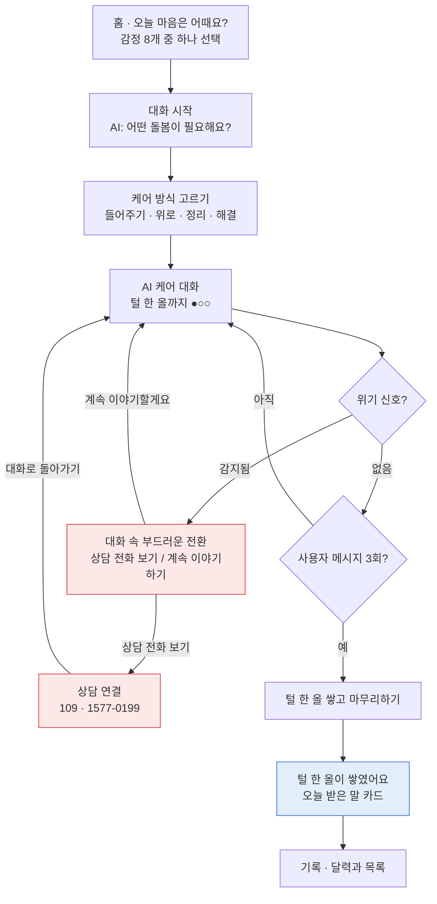
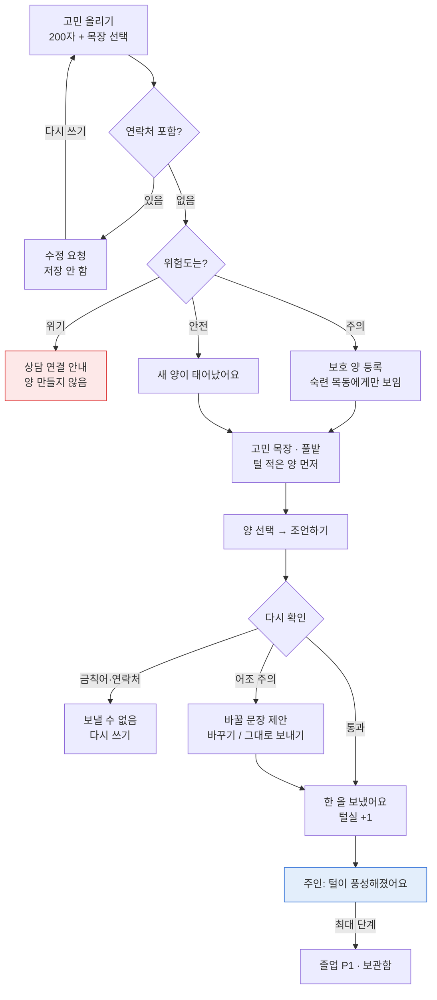

# 털 한 올 — 기능 명세서

2026-11-10 · 김동엽 · 와이어프레임 v3 기준 (닉네임은 사용자가 직접 입력, 가입 후 나 탭에서 변경)

> 11-08 변경: 와이어프레임 v2에 맞춰 흐름을 바꿨습니다. 이전 내용은 `털한올_기능명세서_11-08 와이어프레임v1 기준.md`에 있습니다. 주요 변경은 10장에 정리했습니다.

> 11-10 변경: 와이어프레임 v3로 확정했습니다. 닉네임 규칙이 2~10자로 바뀌고, 가입 후 나 탭에서 닉네임을 바꿀 수 있으며(ME-02), 양 꾸미기는 ME-03이 되었습니다. 주요 변경은 11장에 정리했습니다.

## 1. 개요

'털 한 올'은 두 가지 방식으로 마음을 돌보는 웹 서비스입니다.

- **마음 돌보기 (혼자)**: 홈에서 오늘의 감정을 고르면 바로 AI와의 대화가 시작됩니다. 대화 안에서 그날 필요한 케어 방식을 고르고, 몇 번 이야기를 나눈 뒤 마무리하면 나의 양에 털이 한 올 쌓입니다. 지난 대화는 달력과 목록으로 돌아볼 수 있습니다.
- **고민 목장 (함께)**: 고민을 올리면 털 없는 양 한 마리가 태어나고, 다른 사용자들의 조언이 털이 되어 그 양이 점점 풍성해집니다. 털이 적은 양이 먼저 보이도록 정렬해 모든 고민이 조언을 받게 합니다.

두 공간은 털실로 이어집니다. 고민 목장에서 다른 사람에게 조언을 보내면 털실이 쌓이고, 털실로 나의 양을 꾸밀 수 있습니다.

**범위**: 2026 간지톤 시연용 MVP(웹, 모바일 반응형). 1:1 대화, 전문 상담 매칭, 결제는 범위에서 제외합니다. AI 케어는 의학적 진단이나 치료가 아닌 자기 돌봄 도구로 정의합니다.

**용어 정의**

| 용어 | 의미 |
| --- | --- |
| 오늘의 마음 | 홈에서 고른 대표 감정과 그에 이어지는 AI 대화 한 번. 본인만 볼 수 있음 (이전 '감정 일기') |
| 케어 방식 | 그날 원하는 돌봄 방식 4가지: 이야기 들어주기, 위로받기, 생각 정리하기, 해결 방법 찾기 |
| 케어 대화 | 고른 케어 방식에 맞춰 AI와 나누는 대화 |
| 나의 양 | 사용자마다 한 마리. 케어 대화를 마칠 때마다 털이 한 올씩 쌓이고, 털 3올마다 한 단계씩 자라 5단계까지 성장 |
| 목장 | 고민 주제별 공개 공간 4곳 (진로·취업, 관계, 번아웃, 나 자신) |
| 고민 양 | 목장에 올린 고민 하나. 털 없는 양으로 태어나 조언을 받으며 풍성해짐 |
| 털 한 올 | AI와 이야기하고 마무리하면 쌓이는 털. 나의 양을 자라게 함 |
| 받은 털 | 내 고민에 다른 목동이 보낸 조언. 고민 양을 풍성하게 함 |
| 털실 | 다른 목동에게 조언을 보내면 쌓이는 수치. 나의 양 꾸미기에 사용 |
| 목동 | 서비스를 쓰는 사람. 목장에서는 닉네임으로만 보임 |
| 졸업 | 고민 양이 최대 단계가 되거나 기간이 지나 목장을 떠나 주인의 보관함으로 가는 것 |
| 위험도 | AI가 대화와 고민에 매기는 등급: 안전 / 주의 / 위기 |

## 2. 사용자 및 권한

모든 사용자는 같은 권한의 회원입니다. 케어 대화와 기록은 본인만 볼 수 있고, 고민 목장에서는 닉네임만 보이는 익명으로 활동합니다.

| 역할 | 할 수 있는 것 | 할 수 없는 것 |
| --- | --- | --- |
| 비회원 | 온보딩 소개, 위기 상담 안내 열람 | 케어 대화, 목장 이용 |
| 회원 (마음 돌보기) | 감정 고르기, 케어 대화, 나의 양 보기·꾸미기, 닉네임 바꾸기, 기록 돌아보기, 기록 전체 삭제 | 다른 사용자의 대화·기록 열람 |
| 회원 (고민 목장) | 목장 둘러보기, 고민 올리기, 조언(털) 보내기, 고마워요, 직접 졸업, 신고, 차단 | 내 고민 양에 털 보내기, 같은 양에 두 번 보내기, 조언 작성자 식별, 개인 메시지 |
| 운영자 | 신고 처리, 숨김·복구, 위기 판정 로그(사유 코드만) 조회, 안전 패턴·프롬프트 관리 | 대화 본문 열람, 다른 사용자에게 이메일 노출 |

## 3. 기능 목록

P0는 19개입니다. 시연 핵심 장면은 두 가지입니다: 감정 고르기 → AI 케어 대화 → 나의 양에 털 한 올, 그리고 목장에 털 없는 양이 태어나 다른 계정의 조언으로 풍성해지는 순간. P1은 시간이 남을 때, P2는 발표의 확장 계획으로만 다룹니다.

하단 탭은 **내 우리 / 고민 목장 / 나** 3개입니다. 기록은 홈 오른쪽 위 달력 아이콘에서 엽니다.

| ID | 기능 | 분류 | 우선순위 | 와이어프레임 v3 |
| --- | --- | --- | --- | --- |
| ACC-01 | 회원 가입 (이메일, 닉네임 직접 입력) + 온보딩 | 계정 | P0 | ONB-01~03, ACC-02 |
| ACC-02 | 로그인 / 로그아웃 | 계정 | P0 | ACC-01 |
| ACC-03 | 탈퇴 및 기록 전체 삭제 | 계정 | P1 | ME-01 |
| ACC-04 | 비밀번호 재설정 (이메일) | 계정 | P2 | ACC-01 '비밀번호를 잊었어요' |
| ACC-05 | 닉네임 바꾸기 | 계정 | P1 | ME-02 |
| DRY-01 | 오늘 마음 고르기 (홈) | 마음 돌보기 | P0 | HOME-01 |
| DRY-02 | 기록 (달력 + 목록) 및 상세 | 마음 돌보기 | P0 | REC-01, REC-02 |
| CARE-01 | 대화 안에서 케어 방식 고르기 | 마음 돌보기 | P0 | CHAT-01 |
| CARE-02 | AI 케어 대화 | 마음 돌보기 | P0 | CHAT-02, 02b~02d |
| CARE-03 | 털 한 올 쌓고 마무리 | 마음 돌보기 | P0 | CARE-03 |
| CARE-04 | 케어 방식 추천 | 마음 돌보기 | P2 | (v2에 없음) |
| SHP-01 | 나의 양 성장 | 마음 돌보기 | P0 | HOME-01, CARE-03 |
| SHP-03 | 털실로 나의 양 꾸미기 | 마음 돌보기 | P1 | ME-03 |
| REV-02 | 이번 달 한 줄 돌아보기 | 마음 돌보기 | P1 | REC-01 상단 |
| REV-03 | 월간 AI 회고 편지 | 마음 돌보기 | P2 | |
| FRM-01 | 고민 목장 (주제 탭 + 풀밭) | 고민 목장 | P0 | FARM-03 |
| FRM-03 | 조언하기 화면 (고민 보기) | 고민 목장 | P0 | FARM-04 |
| FRM-04 | 고민 올리기 | 고민 목장 | P0 | FARM-01, FARM-02 |
| FRM-05 | 내 고민 (진행 중) | 고민 목장 | P0 | MGT-01, FARM-05 |
| FRM-06 | 졸업 및 보관함 | 고민 목장 | P1 | MGT-02 |
| FRM-07 | 케어 마무리에서 목장으로 올리기 | 고민 목장 | P1 | CARE-03 하단 |
| WOL-01 | 조언(털) 보내기 | 고민 목장 | P0 | FARM-04, 04b, 04c |
| WOL-02 | 털 도착 푸시 알림 | 고민 목장 | P1 | NOTI-01 |
| WOL-03 | 고마워요 (하트) | 고민 목장 | P1 | FARM-05 |
| SAF-01 | 위험도 분류 (대화·고민) | 안전 | P0 | |
| SAF-02 | 위기 신호 시 대화 속 상담 연결 | 안전 | P0 | CRISIS-01~03 |
| SAF-03 | AI 응답 안전 가드 | 안전 | P0 | |
| SAF-04 | 조언 다시 확인 (금칙어 + AI) | 안전 | P0 | FARM-04b |
| SAF-05 | 개인정보 패턴 차단 (고민·조언) | 안전 | P0 | |
| RPT-01 | 신고 | 신고·운영 | P0 | SAFE-00, SAFE-01, SAFE-02 |
| RPT-02 | 사용자 차단 | 신고·운영 | P1 | SAFE-00, SAFE-02, SAFE-03 |
| UX-01 | 빈 상태 화면 | 공통 | P1 | EMPTY-01, EMPTY-02 |
| ADM-01 | 운영자 신고 처리 화면 | 신고·운영 | P2 | |
| NTF-01 | 매일 기록 알림 | 알림 | P2 | |

v1에서 빠진 기능: 기록 양 우리 배치(SHP-02), 우리별 기록 모아보기(REV-01), 감정 강도·일기 본문 입력, 반짝이는 털실. 감정 캘린더(DRY-03)는 DRY-02에 합쳤습니다.

### 핵심 사용자 흐름

**흐름 A · 마음 돌보기**



**흐름 B · 고민 목장**



## 4. 기능 상세

P0 기능은 입력, 처리, 결과, 예외까지 정의하고, P1·P2는 요구사항만 적습니다. 수치 기준은 5장 정책을 따릅니다.

### 4.1 계정

**ACC-01 회원 가입과 온보딩 (P0)**

- 온보딩: 처음 실행하면 소개 3장(ONB-01~03: 마음을 이야기하면 털 한 올이 쌓여요 / 고민은 목장에 올려요, 양이 되어 닿아요 / 다른 목동의 한마디가 털이 돼요)을 보여주고 '시작하기' 후 로그인 화면으로 이동. '건너뛰기' 가능
- 입력: 이메일, 비밀번호, 닉네임(사용자가 직접 입력), 동의 1개('이용약관과 AI 케어는 전문 상담을 대신하지 않는다는 점에 동의해요')
- 처리: 닉네임은 입력하는 동안 사용 가능 여부(형식, 중복, 금칙어·개인정보)를 바로 알려줍니다. 가입 시 서버가 같은 규칙으로 다시 검증한 뒤 나의 양(1단계, 털 0)을 함께 만듭니다.
- 닉네임 입력란에는 글자 수(n / 10)를 보여 주고, 아래에 '목장에서는 이 이름만 보여요. 실명은 쓰지 마세요.' 안내
- 결과: '내 양 만나기' → 내 우리(홈)
- 예외: 이메일 중복 시 오류 안내. 닉네임이 이미 쓰이고 있거나 규칙에 맞지 않으면 이유를 알려주고 다시 입력 요청(규칙은 5장). 가입 후에는 나 탭 '닉네임 바꾸기'(ACC-05)에서 바꿀 수 있음

**ACC-02 로그인 / 로그아웃 (P0)**

- 이메일·비밀번호 로그인, JWT 기반 인증. 로그인 실패 5회 시 5분 잠금
- 로그아웃은 나 탭 메뉴('로그아웃 · 탈퇴')

**ACC-03 탈퇴 및 기록 전체 삭제 (P1)**

- 탈퇴 시 대화, 나의 양, 고민 양, 보낸 조언을 즉시 삭제. 탈퇴하지 않고 마음 돌보기 기록만 전부 지우는 메뉴('기록 전체 삭제')도 제공

**ACC-04 비밀번호 재설정 (P2)**

- 로그인 화면의 '비밀번호를 잊었어요'. 메일 발송이 필요해 시연 범위에서는 링크만 두고 안내 문구로 대체

**ACC-05 닉네임 바꾸기 (P1)**

- 나 탭 '닉네임 바꾸기'(ME-02): 현재 닉네임이 채워진 입력란, 글자 수(n / 10), '목장에서는 이 이름만 보여요. 실명은 쓰지 마세요.' 안내, '저장'
- 처리: 가입과 같은 규칙(5장)으로 길이·문자·금칙어·개인정보·중복을 검사. 지금 닉네임과 같으면 바뀐 것 없이 성공. 내 이름에서 대소문자만 바꾸는 것은 허용
- 결과: 새 닉네임이 바로 적용되고, 이미 올린 고민·조언에도 새 닉네임이 보임
- 예외: 쓸 수 없는 이유를 입력란 아래에 한 줄로 안내. 변경 횟수 제한은 두지 않음 (초안)

### 4.2 마음 돌보기

**DRY-01 오늘 마음 고르기 (P0)**

- 홈(HOME-01): 닉네임, 달력 아이콘(기록), 나의 양과 단계·진행 바, '오늘 마음은 어때요?'와 감정 8개 칩
- 처리: 감정을 누르면 오늘의 마음 기록을 만들고 바로 케어 대화 화면으로 이동. AI 첫 마디는 감정에 맞춘 고정 문장 + '오늘은 어떤 돌봄이 필요해요?'
- 예외: 하루 시작 한도 초과 시 안내

**DRY-02 기록과 상세 (P0)**

- 기록(REC-01): 달력 + 목록. 날짜마다 그날 감정 표시, 목록 항목은 날짜·감정·오늘 받은 말 한 줄
- 상단 한 줄 돌아보기(REV-02, P1): '이번 달 털 3올을 모았어요', '불안한 날엔 위로받기를 자주 골랐어요'
- 상세(REC-02): 날짜·감정, 받은 털(요약 카드), 내가 한 이야기(첫 메시지), 삭제. 수정은 없음
- 기록을 삭제해도 이미 쌓인 털은 유지

### 4.3 마음 돌보기: 케어

**CARE-01 대화 안에서 케어 방식 고르기 (P0)**

- 대화 첫 화면(CHAT-01)에서 AI가 묻고, 4개 버튼 중 하나를 고릅니다. 버튼 대신 하고 싶은 말을 바로 적을 수도 있습니다('또 하고 싶은 말을 적어도 돼요' — 이 경우 이야기 들어주기로 시작).
- 오늘의 마음 1개당 케어 1회입니다.

| 케어 방식 | AI의 역할 | 마무리 카드에 남는 것 |
| --- | --- | --- |
| 이야기 들어주기 | 판단·조언 없이 공감하며 더 말하고 싶은 것을 묻기 | 내가 털어놓은 마음 한 줄 |
| 위로받기 | 감정을 인정하고 따뜻한 말로 위로하기 | 오늘 받은 위로의 말 |
| 생각 정리하기 | 질문으로 걸리는 것, 느낌, 바꿀 수 있는 것을 나눠 정리하기 | 정리된 생각 세 줄 |
| 해결 방법 찾기 | 상황을 짚고 오늘 해볼 수 있는 작은 행동 제안하기 | 해볼 행동 1~3개 |

**CARE-02 AI 케어 대화 (P0)**

- 상단에 '털 한 올까지 ●○○' 진행 표시. 사용자 메시지 3회가 되면 '털 쌓을 준비가 됐어요'로 바뀌고 '털 한 올 쌓고 마무리하기' 버튼이 나타납니다.
- 응답은 스트리밍으로 표시합니다. 사용자 메시지마다 위험도 분류(SAF-01), AI 응답마다 안전 가드(SAF-03)를 거칩니다.
- 사용자 메시지 최대 10회. 닿으면 AI가 자연스럽게 마무리를 제안합니다.
- 상단 '상담' 링크는 언제든 상담 연결 화면으로 이동
- 예외: AI 응답 실패 시 '잠시 숨을 고르고 있어요' 안내 후 재시도. 3회 실패하면 대화를 저장해 두고 나중에 이어할 수 있게 함

**CARE-03 털 한 올 쌓고 마무리 (P0)**

- AI가 대화를 바탕으로 케어 방식별 카드(오늘 받은 말)를 만듭니다.
- '털 한 올이 쌓였어요' 연출, 단계 진행 바 갱신. 단계가 오르면 털이 부풀어 오르는 연출
- 하단 '이 고민을 목장에도 올려볼까요?'(FRM-07, P1), '내 우리로 돌아가기'
- 예외: 사용자 메시지 3회 전에는 마무리 버튼이 없음. 대화에서 위기 신호가 나왔다면 마무리 카드만 남기고 털은 쌓지 않음(SAF-02)

**CARE-04 케어 방식 추천 (P2)**

- v2에는 없음. 확장 계획으로만 다룸

### 4.4 마음 돌보기: 나의 양

**SHP-01 나의 양 성장 (P0)**

- 홈 중앙에 나의 양, '포근한 양 · 3단계'와 진행 바. 털 3올마다 한 단계, 5단계까지(5장)
- 털이 쌓일 때 털 한 올이 날아와 붙는 애니메이션. 다른 사람과 비교하는 화면은 없음

**SHP-03 털실로 나의 양 꾸미기 (P1)**

- 나 탭 '꾸미기'(ME-03): 목도리, 모자, 방울, 리본. 아이템마다 필요한 털실, 착용 표시, '저장'. 아이템 목록은 고정 데이터로 관리. 필요 털실은 와이어프레임 v3 기준 모자 5, 방울 8, 리본 3이고 목도리는 화면에 값이 없어 임시로 3
- 꾸미기는 모양만 바꾸고 털 단계에는 영향 없음

**REV-02 이번 달 한 줄 돌아보기 (P1)**

- 기록 화면 상단에 이번 달 쌓은 털 수와 '○○한 날엔 ○○를 자주 골랐어요' 한 줄

**REV-03 월간 AI 회고 편지 (P2)**

### 4.5 고민 목장

**FRM-01 고민 목장 (P0)**

- 한 화면(FARM-03): 제목 '고민 목장', 오른쪽 위 '올리기'·'내 고민'
- 주제 탭: 전체 / 진로 / 관계 / 번아웃 / 나 (5장 목장 4곳 + 전체)
- 풀밭에 양들이 흩어져 있고, 양을 누르면 아래 카드에 고민 앞부분·닉네임·작성 시각과 '조언하기' 버튼
- 정렬: 털 적은 순 → 털 수가 같으면 오래된 순. 아직 조언을 못 받은 양이 앞에 나옴
- 제외: 졸업·숨김된 양, 내가 차단했거나 나를 차단한 사용자의 양, 이미 털을 보낸 양은 뒤로. '주의' 양은 조언 보낸 이력이 충분한 사용자에게만 표시(5장)
- 인기 순위나 조회수는 표시하지 않음

**FRM-03 조언하기 화면 (P0)**

- FARM-04: 고민 본문(양 그림과 함께), 조언 입력창(0/100), 기본 문장 3개('오늘 정말 고생 많았어요', '응원할게요', '혼자가 아니에요' — 누르면 입력창에 채움), '털 한 올 보내기'
- 오른쪽 위 ⋯ 메뉴: 신고하기, 이 목동 차단하기(SAFE-00)
- 다른 목동이 보낸 조언은 고민 주인만 봅니다. 털 개수 숫자는 표시하지 않음

**FRM-04 고민 올리기 (P0)**

- 입력(FARM-01): 고민 본문(1~200자), 목장 선택(기본값은 현재 탭), 개인정보 안내
- 처리:
    1. 개인정보 패턴 검사(SAF-05) → 걸리면 저장하지 않고 수정 요청
    2. 위험도 분류(SAF-01)
    3. 안전 → 털 없는 양(1단계)으로 등록. 주의 → '보호 양'으로 등록(5장). 위기 → 양을 만들지 않고 상담 연결 안내(SAF-02)
- 결과(FARM-02): '새 양이 태어났어요' + 고민 인용 → '목장 가기'
- 예외: 하루 한도 초과 시 '내일 다시 들려주세요'. 분류 API 실패 시 금칙어 기반 1차 판정 후 등록, 로그 기록

**FRM-05 내 고민 (P0)**

- 목장 › 내 고민(MGT-01): '진행 중' / '보관함' 탭. 진행 중 양마다 고민 앞부분, 단계, '새 털 n올 도착'
- 양을 누르면 FARM-05: '털이 풍성해졌어요' + 받은 조언 목록(닉네임·시각), 조언마다 하트(WOL-03)
- 하단 '새 고민 올리기'

**FRM-06 졸업 및 보관함 (P1)**

- 최대 단계 도달, 작성 후 7일 경과, 또는 주인이 직접 졸업시키면 보관함(MGT-02)으로 이동. 받은 조언을 다시 볼 수 있음

**FRM-07 케어 마무리에서 목장으로 올리기 (P1)**

- 케어 마무리 화면의 버튼을 누르면 빈 고민 올리기 화면으로 이동. 대화 원문은 자동으로 채우지 않음. 목장만 미리 추천

### 4.6 고민 목장: 조언(털)

**WOL-01 조언(털) 보내기 (P0)**

- 입력: 조언·응원 메시지(1~100자)
- 처리:
    1. 권한 검증: 내 양이 아니고, 이 양에 보낸 적이 없고, 졸업·숨김되지 않은 양만 허용
    2. 다시 확인(SAF-04, SAF-05)
    3. 통과 → 저장, 고민 양 털 +1 후 단계 재계산, 보낸 사람 털실 +1
- 결과(FARM-04c): '한 올 보냈어요', '털실 1개를 받았어요', '목장으로' / '내 양 꾸미러 가기'
- 예외: 그 사이 양이 졸업했다면 '이 양은 방금 목장을 떠났어요' 안내

**WOL-02 털 도착 푸시 알림 (P1)**

- 내 고민 양에 털이 도착하면 웹 푸시 '털이 풍성해졌어요'(NOTI-01). 누르면 FARM-05로 이동. 알림을 허용하지 않았거나 앱이 열려 있으면 앱 안 토스트

**WOL-03 고마워요 (P1)**

- FARM-05에서 받은 조언마다 하트 1회. 보낸 사람에게 알림

### 4.7 안전

**SAF-01 위험도 분류 (P0)**

- 대상: 케어 대화의 사용자 메시지, 고민 본문
- 1차: 위기 키워드 사전 매칭(즉시). 2차: LLM이 안전 / 주의 / 위기 중 하나와 사유 코드를 JSON으로 반환. 둘 중 더 높은 등급을 사용
- 판정 결과와 사유 코드만 crisis_logs에 기록하고 본문은 로그에 남기지 않음

**SAF-02 위기 신호 시 대화 속 상담 연결 (P0)**

- 대화 중 위기로 판정되면(CRISIS-01) AI 응답 대신 부드러운 전환 메시지: '잠깐 멈출게요. 지금은 전화로 이야기할 수 있는 곳을 알려드리고 싶어요.' + '상담 전화 보기' / '괜찮아요, 계속 이야기할게요'
- 상담 연결(CRISIS-02): '전화로 이야기해 볼래요?', 자살예방 상담전화 109, 정신건강 위기상담 1577-0199, '두 곳 모두 24시간 받아요. 지금 위험하다면 119에 바로 연락해 주세요', '109에 전화하기', '대화로 돌아가기'
- 대화로 돌아오면(CRISIS-03) AI가 '말해 줘서 고마워요. 천천히 이어서 말해 줘도 돼요. 위에 있는 "상담"은 언제든 누를 수 있어요.'로 이어감
- 위기 신호가 나온 대화는 마무리해도 털을 쌓지 않습니다. 게임 요소가 위기 순간에 끼어들지 않게 하기 위함입니다.
- 위기 판정 후 24시간 동안 상단에 상담 안내 배너 유지. 고민 올리기에서 위기로 판정되면 양을 만들지 않고 같은 상담 연결 화면 표시
- 나 탭 '힘들 때 도움받을 곳'과 비회원 고정 메뉴로도 상담 연결 화면 제공

**SAF-03 AI 응답 안전 가드 (P0)**

- 시스템 프롬프트로 금지: 병명 단정이나 진단, 약 복용·중단 조언, 자해·위험 행동 방법, AI만 의지하라는 식의 말
- AI 응답을 화면에 내보내기 전 안전 패턴 검사. 걸리면 미리 준비한 안전 문장으로 대체
- 케어 대화 상단에 '상담' 링크 상시 표시

**SAF-04 조언 다시 확인 (P0)**

- 1차 금칙어(욕설, 혐오, 성적 표현), 개인정보 패턴(SAF-05), 자해 조장 → 보낼 수 없음. 다시 쓰기 요청
- 2차 LLM 분류: 비난, 다그침·훈계, 비교('너만 힘든 거 아니야'), 조롱, 섣부른 진단, 종교·상품 권유
    - 걸리면 FARM-04b: '다그치는 말처럼 들릴 수 있어요' + AI가 바꾼 문장 제안. '이 문장으로 바꾸기' 또는 '그대로 보내기'
    - '그대로 보내기'를 고르면 그대로 저장. 그대로 보낸 조언도 신고 대상
- LLM 지연·실패 시 금칙어 판정만으로 처리

**SAF-05 개인정보 패턴 차단 (P0)**

- 고민, 조언, 닉네임에 적용. 전화번호, 이메일, SNS 아이디(@, 오픈채팅 링크), 계좌번호 형식 정규식 차단
- 외부 연락으로 이어지는 통로를 막는 것이 목적

### 4.8 신고·운영·공통

**RPT-01 신고 (P0)**

- 조언하기 화면 ⋯ › 신고하기(SAFE-01): '어떤 점이 걱정되나요?', 신고 대상 미리보기, 사유(악성 표현 / 개인정보 / 홍보·스팸 / 글쓴이가 위험해 보여요 / 기타)
- 신고 완료(SAFE-02): '신고했어요', '이 목동 차단하기' 토글
- 신고 누적 3회 시 자동 숨김. '위험해 보여요' 신고는 1회만으로 양의 주인에게 상담 안내 배너 노출

**RPT-02 차단 (P1)**

- ⋯ 메뉴 또는 신고 완료 화면에서 차단. 나 탭 '차단한 목동 관리'(SAFE-03)에서 해제
- 차단하면 서로의 고민 양이 목장에서 보이지 않음

**UX-01 빈 상태 화면 (P1)**

- 내 고민이 없을 때(EMPTY-01): '아직 올린 고민이 없어요' + '고민 올리기'
- 기록이 없을 때(EMPTY-02): '아직 기록이 없어요' + '털 한 올 쌓으러 가기'

**나 탭 (ME-01)**

- 닉네임, 털실, '꾸미기' 버튼, '닉네임 바꾸기' 버튼
- 메뉴: 힘들 때 도움받을 곳, 차단한 목동 관리, 기록 전체 삭제, 로그아웃 · 탈퇴

**ADM-01 운영자 화면 (P2)**, **NTF-01 매일 기록 알림 (P2)**

## 5. 정책 및 수치

아래 수치는 시연 기준 초안이며, 설정값으로 분리해 조정할 수 있게 합니다.

**감정 목록**: 기쁨 / 평온 / 지침 / 불안 / 우울 / 외로움 / 화남 / 복잡함

**목장 목록 (4곳)**: 진로·취업 / 관계(가족·친구·연애) / 번아웃(일·학업) / 나 자신(자존감·불안). 탭 이름은 진로 / 관계 / 번아웃 / 나

**마음 돌보기**

| 항목 | 기준값 | 비고 |
| --- | --- | --- |
| 하루 대화 시작 | 최대 3회 | |
| 오늘의 마음 1개당 케어 | 1회 | |
| 털 쌓기 조건 | 사용자 메시지 3회 이상 + 마무리 | '털 한 올까지 ●○○' |
| 케어 대화 길이 | 사용자 메시지 최대 10회 | 비용과 피로 관리 |
| AI 응답 길이 | 300자 이내 권장 | 모바일 가독성 |
| 털 지급량 | 케어 1회당 1올 | |

**고민 목장**

| 항목 | 기준값 | 비고 |
| --- | --- | --- |
| 고민 길이 | 1~200자 | |
| 조언 길이 | 1~100자 | |
| 하루 고민 올리기 한도 | 3마리 | 과도한 노출 방지 |
| 같은 양에 보낼 수 있는 조언 | 1인 1개 | 몰아주기 방지 |
| 고민 양 1마리당 털 상한 | 10개 | 최대 단계 도달 시 졸업 |
| 자동 졸업 기간 | 작성 후 7일 | P1 |
| 목장 정렬 | 털 적은 순 → 오래된 순 | 소외되는 고민 방지 |
| 목장 한 페이지 | 20마리 | |
| '주의' 고민 양 보호 표시 | 조언 보낸 이력 5회 이상 사용자에게만 표시, 기본 문장 위주 노출 | 무거운 고민의 대리 외상 방지 |
| 자동 숨김 | 신고 3회 | |

**공통**

| 항목 | 기준값 |
| --- | --- |
| 위기 판정 시 | 대화 속 상담 연결 전환, 그 대화는 털 없음, 고민은 양 만들지 않음 |
| 위기 배너 유지 | 24시간 |
| 로그인 잠금 | 실패 5회, 5분 |
| 닉네임 | 2~10자, 한글·영문·숫자·공백(앞뒤 공백 제거, 공백 연속 불가). 중복 불가(영문 대소문자 구분 없음). 금칙어·개인정보 패턴(SAF-04, SAF-05)과 '운영자', '관리자', '털 한 올' 같은 사칭 단어 사용 불가. 가입 후 나 탭에서 바꿀 수 있음(ACC-05) (초안) |
| 비밀번호 | 8자 이상 (초안) |

**양 단계**

| 단계 | 이름 | 나의 양 (누적 털) | 고민 양 (받은 조언) |
| --- | --- | --- | --- |
| 1 | 털 깎은 양 | 0 | 0 |
| 2 | 보송한 양 | 3 | 1 |
| 3 | 포근한 양 | 6 | 3 |
| 4 | 몽글몽글 양 | 9 | 6 |
| 5 | 구름 양 | 12 | 10 |

나의 양은 털 3올마다 한 단계씩 자라 하루 한 번씩 케어하면 약 2주 만에, 고민 양은 조언 10개를 받으면 구름 양이 됩니다.

**보상 규칙**

- AI 케어 1회 마무리(메시지 3회 이상): 나의 양 털 +1
- 조언 1개 받음: 그 고민 양의 털 +1
- 조언 1개 보냄: 보낸 사람 털실 +1
- 보낼 수 없는 조언, 위기 신호가 나온 대화에는 보상 없음

## 6. 비기능 요구사항

| 구분 | 요구사항 |
| --- | --- |
| 개인정보 | 대화 본문과 요약은 민감 정보로 보고 DB에 암호화 저장, 운영자도 열람 불가. 대화 내용은 어떤 경로로도 자동 공개되지 않음. 이메일은 로그인에만 쓰고 다른 사용자에게 노출하지 않음. 실명은 수집하지 않음 |
| 익명성 | 목장 관련 API 응답에 상대방의 user_id·이메일을 노출하지 않음. 닉네임만 반환. 가입 화면에서 닉네임에 실명·연락처를 쓰지 않도록 안내 |
| AI 데이터 | LLM API에는 본문만 보내고 이메일·닉네임은 제외. 학습에 쓰이지 않는 API 설정 사용 |
| 접근 제어 | 대화·기록은 본인만. 목장은 로그인 회원만. 받은 조언 목록은 고민 주인만. 조언 보내기는 서버에서 '내 양 아님, 중복 아님, 졸업 전'을 검증 |
| 동시성 | 케어 마무리와 나의 양 털 증가, 조언 저장과 고민 양 털 증가는 각각 한 트랜잭션에서 처리. 고민 양 털 상한(10개) 초과 저장이 없어야 함 |
| 응답 속도 | AI 케어 첫 글자 3초 이내(SSE 스트리밍). 조언 보내기 응답 3초 이내, LLM 지연 시 5초 타임아웃 후 금칙어 판정으로 대체 |
| 안정성 | 분류 실패 시 안전한 쪽(주의 등급, 상담 배너)으로 처리 |
| 비용 | 대화 길이 상한, 긴 대화는 앞부분 요약. 금칙어로 명확히 걸리는 조언은 LLM 호출 생략 |
| 접근성 | 모바일 우선 반응형, 버튼 최소 44px, 애니메이션 끄기 옵션 |
| 어조 | 모든 안내 문구는 비난·명령 없이 존댓말. 오류 문구도 따뜻한 표현 사용 |

## 7. 데이터 모델과 API

나의 양(my_sheep)과 고민 양(worry_sheep)은 성장 규칙과 공개 범위가 달라 테이블을 나눕니다. diaries 하나가 '오늘의 마음' 한 번(감정 + 케어 대화 1회)에 대응합니다. 목장은 (farm_id, status, wool_count, created_at) 복합 인덱스로 '털 적은 양 먼저'를 빠르게 조회하고, wools의 (sheep_id, sender_id) 유니크 제약으로 1인 1조언을 보장합니다.

**테이블**

| 테이블 | 주요 컬럼 | 관련 기능 |
| --- | --- | --- |
| users | id, email(UNIQUE), password_hash, nickname(UNIQUE), yarn_count, sent_wool_count, login_fail_count, locked_until, crisis_banner_until, created_at | ACC |
| my_sheep | id, user_id(UNIQUE), wool_count, stage, updated_at | SHP-01 |
| my_sheep_items | id, my_sheep_id, item_code, equipped | SHP-03 |
| diaries | id, user_id, emotion, risk_level, crisis_detected, care_type, care_status(none / in_progress / completed), user_message_count, created_at | DRY, CARE |
| care_messages | id, diary_id, role(user / ai), content(암호화), created_at | CARE-02 |
| care_summaries | id, diary_id(UNIQUE), summary(암호화), completed_at | CARE-03 |
| farms | id, code, name, tab_name, description, sort_order | FRM-01 |
| worry_sheep | id, user_id, farm_id, content, risk_level, wool_count, stage, status(active / graduated / hidden), created_at, graduated_at | FRM |
| wools | id, sheep_id, sender_id, content, sent_as_is, created_at, UNIQUE(sheep_id, sender_id) | WOL-01 |
| thanks | id, wool_id(UNIQUE), created_at | WOL-03 |
| push_subscriptions | id, user_id, endpoint, keys, created_at | WOL-02 |
| reports | id, reporter_id, target_type, target_id, reason, status | RPT-01 |
| blocks | id, blocker_id, blocked_id | RPT-02 |
| crisis_logs | id, user_id, source(message / worry), keyword_hit, llm_level, reason_code, created_at | SAF-01 |
| safety_patterns | id, pattern, category(crisis_keyword / banned_word / ai_output / pii) | SAF-01, SAF-03~05 |

**API: 계정·마음 돌보기**

| Method | Endpoint | 기능 ID | 비고 |
| --- | --- | --- | --- |
| GET | /auth/nickname/availability | ACC-01 | nickname 쿼리, 응답 available + 사용 불가 이유 |
| POST | /auth/signup | ACC-01 | email, password, nickname, 동의. 나의 양 함께 생성 |
| POST | /auth/login | ACC-02 | email, password. JWT 발급 |
| PUT | /users/me/nickname | ACC-05 | nickname. 닉네임 바꾸기, 가입과 같은 규칙 |
| POST | /diaries | DRY-01 | emotion. 응답에 diaryId, AI 첫 마디 |
| POST | /diaries/{id}/care | CARE-01 | careType 지정, AI 첫 메시지 반환 |
| POST | /diaries/{id}/care/messages | CARE-02, SAF-01, SAF-03 | SSE: 응답 조각, 진행(userMessageCount, ready), 위기 전환 이벤트 |
| POST | /diaries/{id}/care/complete | CARE-03, SHP-01 | 마무리 카드 + 털 결과 |
| GET | /diaries?month=YYYY-MM | DRY-02 | 달력 + 목록 |
| GET | /diaries/{id} | DRY-02 | 감정, 받은 털, 내가 한 이야기, 대화 |
| DELETE | /diaries/{id} | DRY-02 | 삭제 |
| GET | /diaries/summary?month=YYYY-MM | REV-02 | 한 줄 돌아보기 (P1) |
| GET | /my-sheep | SHP-01 | 단계, 누적 털, 털실, 착용 아이템 |
| PUT | /my-sheep/items | SHP-03 | 아이템 만들기(털실 차감)·착용 저장 |
| DELETE | /me/records | ACC-03 | 기록 전체 삭제 |
| DELETE | /me | ACC-03 | 탈퇴 |

**API: 고민 목장·안전**

| Method | Endpoint | 기능 ID | 비고 |
| --- | --- | --- | --- |
| GET | /farms | FRM-01 | 목장 4곳 + 털을 기다리는 양 수 |
| GET | /farms/{farmCode}/sheep | FRM-01 | farmCode=all 가능. 털 적은 순, page |
| POST | /farms/{farmCode}/sheep | FRM-04, SAF-01, SAF-05 | 응답 status: created / crisis / pii_rejected |
| GET | /worry-sheep/{id} | FRM-03, FRM-05 | 고민. 주인이면 받은 조언 목록 포함 |
| GET | /worry-sheep/me?status=active\|graduated | FRM-05, FRM-06 | 내 고민 |
| POST | /worry-sheep/{id}/graduate | FRM-06 | 주인이 직접 졸업 |
| POST | /worry-sheep/{id}/wools | WOL-01, SAF-04, SAF-05 | content, sendAsIs. 응답 status: sent / suggest(category, suggestion) / blocked(category) |
| POST | /wools/{id}/thanks | WOL-03 | 양의 주인만, 1회 |
| POST | /push/subscriptions | WOL-02 | 웹 푸시 구독 |
| POST | /reports | RPT-01 | |
| GET / POST / DELETE | /blocks | RPT-02 | 차단 목록, 차단, 해제 |
| GET | /help/crisis | SAF-02 | 비회원 접근 가능 |

**응답 예시**

```json
// POST /diaries
{ "diaryId": 101, "firstMessage": "많이 지쳤구나. 오늘은 어떤 돌봄이 필요해요?" }

// SSE event: progress
{ "userMessageCount": 3, "ready": true }

// SSE event: crisis
{ "message": "잠깐 멈출게요. 지금은 전화로 이야기할 수 있는 곳을 알려드리고 싶어요.", "actions": ["call", "continue"] }

// POST /diaries/{id}/care/complete
{
  "summary": { "careType": "comfort", "text": "오늘 하루를 끝까지 버텨낸 것도 분명히 앞으로 나아간 거예요." },
  "wool": { "added": 1, "total": 7, "stage": 3, "stageUp": false }
}

// POST /worry-sheep/{id}/wools
{ "status": "suggest", "category": "LECTURE", "suggestion": "많이 애쓰고 있다는 게 느껴져요." }
{ "status": "sent", "woolId": 7, "yarnCount": 13 }
```

## 8. 화면 목록 (와이어프레임 v3)

| 구역 | 화면 |
| --- | --- |
| 01 시작 | ONB-01~03 소개, ACC-01 로그인, ACC-02 가입 (닉네임 직접 입력, 규칙 메모 포함) |
| 02 내 우리 | HOME-01 감정 고르기, CHAT-01 케어 방식 고르기, CHAT-02/02b/02c/02d 케어 대화 4종, CARE-03 털 한 올 쌓였어요 |
| 03 기록·나·꾸미기 | REC-01 기록(달력+목록), REC-02 상세, ME-01 나 탭, ME-02 닉네임 바꾸기, ME-03 양 꾸미기 |
| 04 고민 목장 | FARM-01 고민 올리기, FARM-02 새 양 탄생, FARM-03 풀밭, FARM-04 조언하기, FARM-04c 보낸 뒤, FARM-05 털이 풍성해졌어요 |
| 05 위기 | CRISIS-01 대화 속 전환, CRISIS-02 상담 연결, CRISIS-03 대화로 돌아옴 |
| 06 관리·안전 | MGT-01 내 고민, MGT-02 보관함, FARM-04b 조언 다시 확인, SAFE-00 ⋯ 메뉴, SAFE-01 신고, SAFE-02 신고 완료·차단, SAFE-03 차단한 목동 |
| 07 빈 상태·알림 | EMPTY-01 내 고민 없음, EMPTY-02 기록 없음, NOTI-01 푸시 알림 |
| 08 규칙 | 털 · 받은 털 · 털실 규칙 |

## 9. 와이어프레임과 다른 점

- v3에서 가입 화면의 닉네임 직접 입력과 가입 후 닉네임 바꾸기가 반영되어 이전의 차이는 없어졌습니다.
- 홈·신고·차단 화면의 닉네임 뒤 숫자 꼬리표(예: '다정한 목동 #2731')는 닉네임 중복 불가 규칙과 맞지 않아 구현하지 않습니다. 디자인 확인 필요

## 10. 11-08 변경 요약 (v1 → v2)

| 항목 | v1 | v2 |
| --- | --- | --- |
| 가입·로그인 | 아이디, 이메일 수집 안 함 | 이메일 + 비밀번호 |
| 닉네임 | 자동 생성 | 사용자가 직접 입력 |
| 일기 | 감정 + 강도 + 본문 1000자 | 홈에서 감정만 고르고 바로 대화 |
| 케어 방식 선택 | 별도 화면 | 대화 안에서 선택 |
| 털 쌓기 조건 | 사용자 답장 1회 | 사용자 메시지 3회 |
| 우리·기록 양 | 우리 4곳, 우리 상세 | 없음. 기록은 달력+목록 |
| 양 단계 | 0/3/10/20/30 | 털 3올마다 (0/3/6/9/12) |
| 목장 | 8곳, 목장 목록 화면 | 4곳, 한 화면 탭 |
| 조언 필터 | 걸리면 다시 쓰기 | 금칙어·연락처는 차단, 어조는 바꿀 문장 제안 + 그대로 보내기 |
| 받은 조언 공개 | 모두 공개 | 고민 주인만 |
| 위기 | 케어 중단 + 상담 화면 | 대화 속 전환, 계속 이야기 가능, 그 대화는 털 없음 |
| 알림 | 앱 안 토스트 | 웹 푸시 + 앱 안 토스트 |
| 고마워요 | 반짝이는 털실 +1 | 하트, 보상 없음 |
| 하단 탭 | 4개 | 3개 (기록은 홈 달력 아이콘) |

## 11. 11/10 변경 요약 (v2 → v3)

| 항목 | v2 | v3 |
| --- | --- | --- |
| 닉네임 길이 | 2~12자 | 2~10자 (가입·변경 화면에 n / 10 표시) |
| 닉네임 변경 | 가입 후 변경 없음 | 나 탭 '닉네임 바꾸기'(ME-02, ACC-05) |
| 가입 화면 | 닉네임 입력으로 변경 예정 | 닉네임 입력란과 규칙 메모 반영 |
| 양 꾸미기 화면 | ME-02 | ME-03 (모자 5, 방울 8, 리본 3 털실 표시) |
